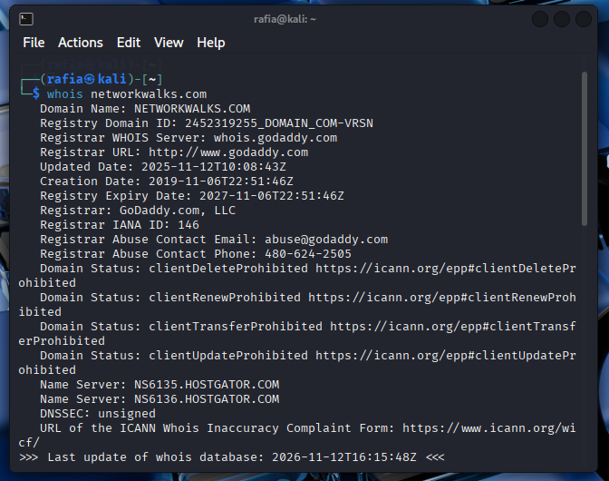
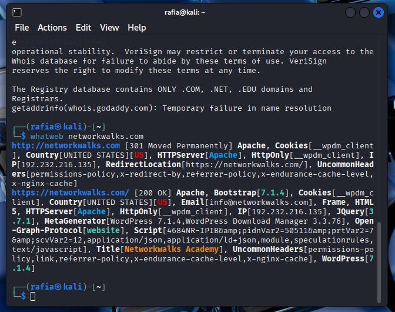
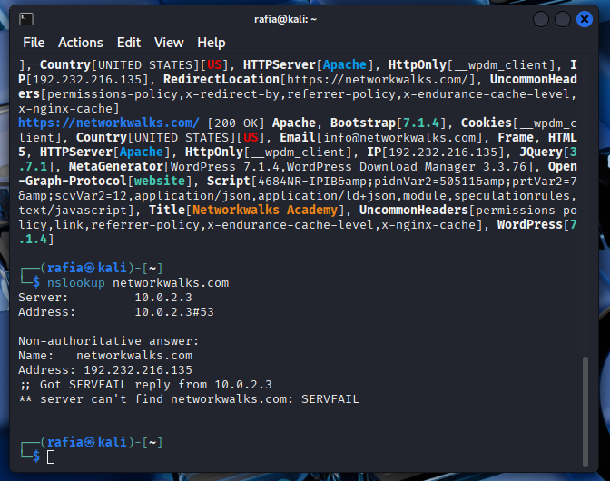
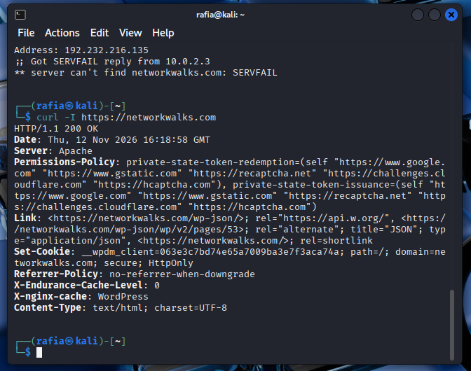
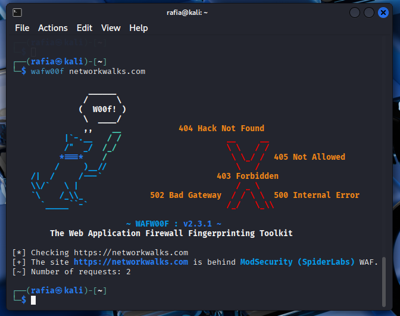
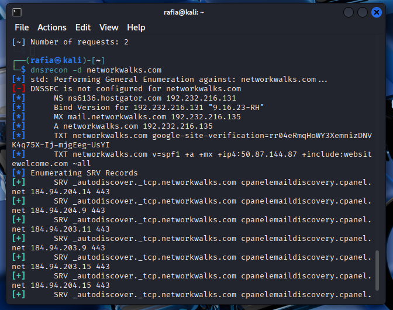
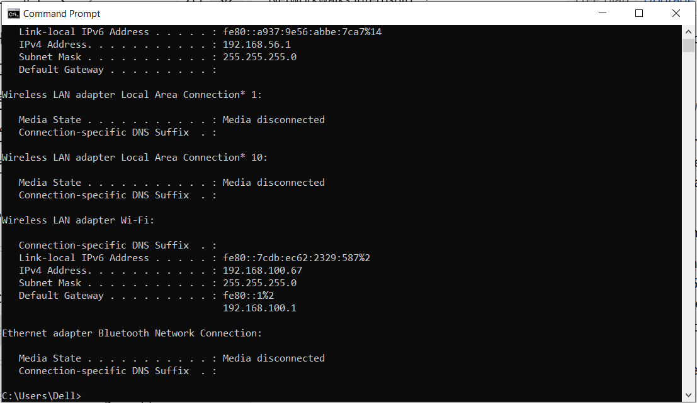
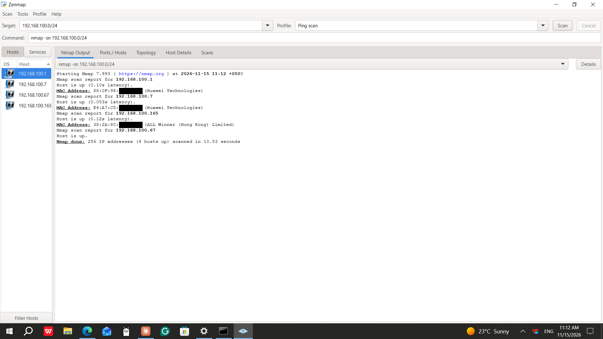
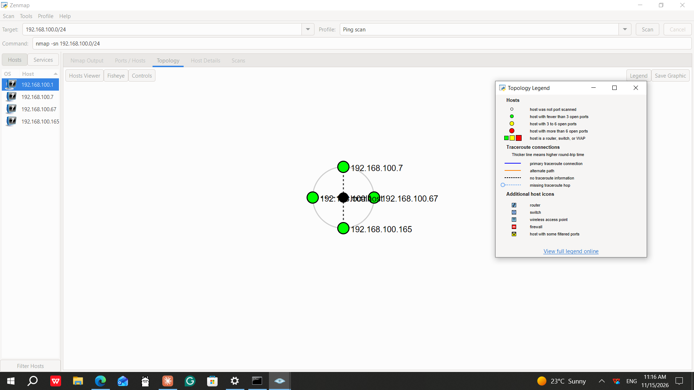

# Footprinting and Network Scanning Lab (Week 2)

Week 2 projects (W2-PM1 and W2-PM5) from my Cybersecurity Internship at Networkwalks (Batch B084).

In this lab I gathered public information about an assigned target domain using six Kali Linux tools, and then scanned my own home network with Zenmap to find live devices. Together they show how an attacker moves from collecting public information to mapping hosts on a network.

> **Disclaimer:** This work is for education only. I only tested a target assigned by the internship program and a network that I own. Do not scan or test systems you do not own or do not have written permission to test.

---

## Scope

| Item | Detail |
|---|---|
| Author | Rafia Noor |
| Program | Cybersecurity Internship, Networkwalks (Batch B084) |
| Modules | W2-PM1 (Footprinting with multiple Kali tools), W2-PM5 (Zenmap scanning) |
| Target 1 | `networkwalks.com`, the lab target assigned by the internship program |
| Target 2 | My own home network, `192.168.100.0/24` |
| Footprinting date | 12 November 2026 (Kali Linux in VirtualBox) |
| Scanning date | 15 November 2026 (Windows with Zenmap) |
| Type of work | Information gathering only. No exploitation was performed. |

---

## Tools Used

| Tool | Purpose |
|---|---|
| `whois` | Domain registration details (registrar, dates, name servers) |
| `whatweb` | Fingerprint web technologies (server, CMS, plugins, IP) |
| `nslookup` | Resolve the domain name to its IP address |
| `curl -I` | Read the HTTP response headers |
| `wafw00f` | Detect a Web Application Firewall |
| `dnsrecon` | Enumerate DNS records (NS, MX, SPF/TXT, SRV) |
| Zenmap (Nmap GUI) | Ping scan of the local subnet to find live hosts |
| `ipconfig` (Windows) | Find my local IP address, subnet and gateway |

---

## Part 1: Footprinting `networkwalks.com` (W2-PM1)

### Task 1: whois

```bash
whois networkwalks.com
```

- Registrar: GoDaddy.com, LLC
- Created: 6 November 2019, expires: 6 November 2027
- Name servers: `NS6135.HOSTGATOR.COM` and `NS6136.HOSTGATOR.COM`, so the site is hosted with HostGator
- DNSSEC: unsigned
- The lookup of the registrar's own WHOIS server ended with a name resolution error, so only the registry data was returned.



### Task 2: whatweb

```bash
whatweb networkwalks.com
```

- Web server: Apache
- CMS: WordPress 7.1.4, plugin WordPress Download Manager 3.3.76, jQuery 3.7.1
- Server IP: `192.232.216.135`
- A contact email address is exposed in the page, and HTTP redirects to HTTPS.



### Task 3: nslookup

```bash
nslookup networkwalks.com
```

- The domain resolves to `192.232.216.135`.
- A SERVFAIL message also appeared after the answer. It looks like a limitation of my lab network's DNS and not a property of the target.



### Task 4: curl -I (HTTP headers)

```bash
curl -I https://networkwalks.com
```

- Status `200 OK`, server banner `Apache`
- `X-nginx-cache: WordPress` shows a caching layer is in use
- The `Link` header exposes the WordPress REST API at `/wp-json/`
- The session cookie is set with the `Secure` and `HttpOnly` flags



### Task 5: wafw00f

```bash
wafw00f networkwalks.com
```

- Result: the site is behind a **ModSecurity (SpiderLabs)** WAF.



### Task 6: dnsrecon

```bash
dnsrecon -d networkwalks.com
```

- DNSSEC is not configured
- DNS software version: Bind 9.16.23-RH
- Mail server: `mail.networkwalks.com`
- SPF record ends in `~all` (soft fail)
- Several cPanel autodiscover SRV records



---

## Part 2: Network Scanning with Zenmap (W2-PM5)

### Step 1: Find my network

I ran `ipconfig` on Windows. My Wi-Fi adapter used a private address in the `192.168.100.0/24` network, with `192.168.100.1` as the default gateway (my router).



### Step 2: Ping scan

In Zenmap I used the **Ping scan** profile, which runs:

```bash
nmap -sn 192.168.100.0/24
```

The scan covered 256 addresses, found **4 live hosts** and finished in 10.53 seconds.

| IP address | MAC address (last 3 parts hidden) | Vendor | Notes |
|---|---|---|---|
| 192.168.100.1 | 88:CF:98:xx:xx:xx | Huawei Technologies | My router (default gateway) |
| 192.168.100.7 | E4:A7:C5:xx:xx:xx | Huawei Technologies | Not yet identified |
| 192.168.100.165 | 38:2A:8C:xx:xx:xx | ALL Winner (Hong Kong) Limited | Not yet identified |
| 192.168.100.67 | not shown by Nmap | n/a | My own computer |

I hid the last three parts of each MAC address because this repository is public. The vendor name only shows who made the network chip, not what the device is, so the two unidentified devices should be checked against my router's connected-devices list.



### Step 3: Topology

I opened the **Topology** tab, turned on the legend and saved the graphic as a PDF: [`evidence/topology_192_168_100_0-24.pdf`](evidence/topology_192_168_100_0-24.pdf)



---

## Risk Analysis

These are observations from information gathering, not confirmed vulnerabilities. No exploitation or vulnerability validation was done.

| # | Finding | Evidence | Potential impact | Level |
|---|---|---|---|---|
| 1 | Domain registration information exposed | Registrar, dates, HostGator name servers, unsigned DNSSEC | Reveals the hosting provider and details useful for social engineering | Low |
| 2 | Web technology information exposed | WordPress 7.1.4, WP Download Manager 3.3.76, Apache, email address | Attackers can look up known issues for exposed versions | Medium |
| 3 | Server IP address identifiable | `192.232.216.135` | Shows the network location of the web service | Low |
| 4 | HTTP technical information exposed | Apache banner, cache header, `/wp-json/` REST API | Helps fingerprinting and further enumeration | Low |
| 5 | WAF technology identifiable | ModSecurity (SpiderLabs) | Reveals part of the security architecture | Low |
| 6 | DNS infrastructure information exposed | NS, MX, SPF/TXT, SRV records, Bind version, no DNSSEC | Helps build a broader infrastructure profile | Medium |
| 7 | Multiple live hosts on the local network | 4 hosts found on `192.168.100.0/24` | Unknown devices could be present on a network | Medium |

---

## Recommendations

1. Review which technology information is publicly visible (CMS, plugins, versions).
2. Keep WordPress, plugins and other software updated.
3. Review HTTP response headers and remove unnecessary technical detail.
4. Review DNS records regularly, and consider DNSSEC and a stricter SPF policy.
5. Keep the WAF enabled and properly tuned.
6. Scan your own network regularly to find active devices.
7. Investigate any unknown device that appears.
8. Keep network and device documentation up to date.
9. Only perform reconnaissance and scanning with authorization.

---

## What I Learned

*(Replace this with your own words before publishing.)*

- How each tool shows a different piece of a target's public profile
- That reconnaissance uses only public information, which is why it is hard to detect
- How a ping scan finds live hosts, and why MAC vendors do not tell you what a device is
- How to document findings clearly: what I ran, what I saw, what it means and what to do about it

---

## Repository Structure

```
.
├── README.md
├── screenshots/        # terminal, ipconfig, Zenmap results and topology
└── evidence/
    └── topology_192_168_100_0-24.pdf
```
